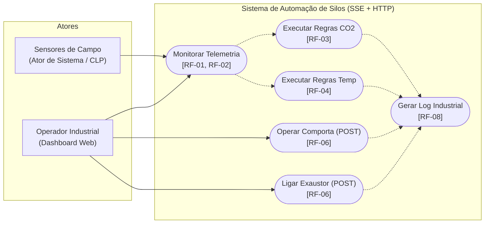
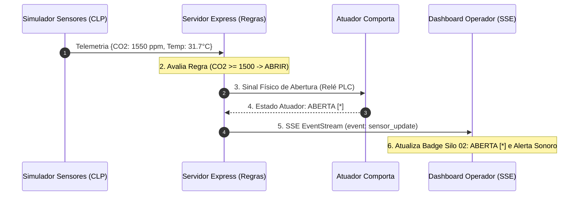
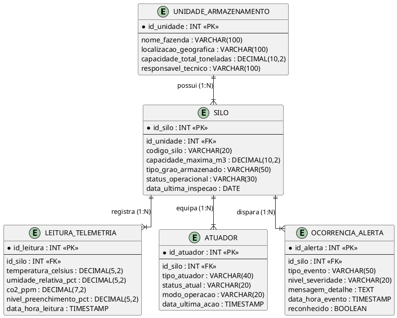

# Especificação Arquitetural e Diagramas UML
## Atividade Prática — SSE2 (UML Completo)
**Docente:** Me. Sergio Souza Novak  
**Disciplina:** Desenvolvimento de Software para Web  
**Instituição:** UniRV - Universidade de Rio Verde  

---

### 1. Diagrama de Casos de Uso (TikZ UML / Mermaid)

Atores do sistema:
- **Operador Industrial (Dashboard Web)**: Acessa o dashboard, monitora telemetria, visualiza cortes térmicos e opera atuadores manuais via HTTP REST.
- **Sensores de Campo (Ator de Sistema / CLP)**: Coleta e transmite telemetria em tempo real dos silos verticais.

---

### 2. Diagrama de Sequência de Automação e SSE

Detalhamento da linha do tempo: detecção de $CO_2$ elevado ($\ge 1500$ ppm), disparo automático de abertura da comporta de ventilação e push via Server-Sent Events para os dashboards conectados:

---

### 3. Diagrama Entidade-Relacionamento do Banco de Dados (PlantUML ERD)

